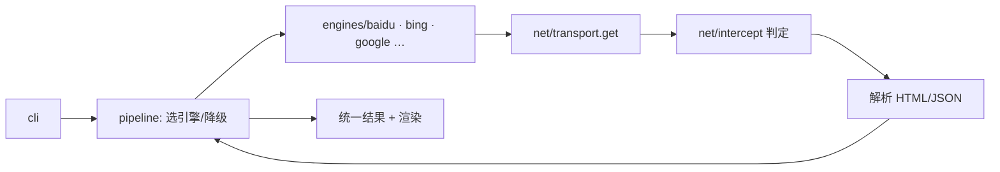
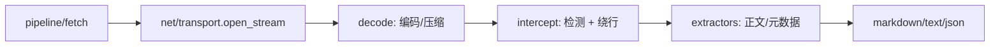

# 架构

## 定位

一个纯 Python（`requires-python >= 3.9`）的采集工具：搜索聚合、单页正文、热榜、RSS、站内搜索，
通过 `webtool` CLI 和 MCP 暴露。没有服务端，所有状态在本地文件里。

## 分层

```
cli/       参数解析、输出格式、退出码。唯一可以 import 所有层的地方
  │
  ├── pipeline/   编排：搜索降级、抓取流水线、渲染
  ├── engines/    具体站点/引擎适配（baidu/bing/wechat/sites…）
  ├── sources/    统一取数契约（DataPacket + SourceBase）
  ├── feeds/      RSS/Atom 订阅
  ├── radar/      RSSHub 路由发现与物化
  ├── render/     字符渲染（text/image/video/music）
  └── filters/    日期窗、去重、黑名单
        │
        ├── net/    netx(出网决策) / transport(指纹通道) / http(urllib 兜底) / intercept / captcha / proxy / rules
        ├── dao/    state(冷却等状态) / cache(响应缓存)
        └── core/   bootstrap / config_data / plugins / logging
```

依赖方向只能向下。唯一的权威是 `tests/test_layering.py`：新增 import 后跑一遍，
越界会直接失败。实践中的三条硬线：

- `net/` 不认识 `engines/`、`pipeline/`、`cli/`（只依赖 `core` + `dao`）。
- `engines/` 不认识 `cli/`、`pipeline/`。
- 任何层都不绕过 `net/transport` 自己发 HTTP。

## 一次请求怎么走

**搜索**



某条线路被拦或失败时，`pipeline` 按引擎优先级降级；是否还能重试由
`net/intercept` 的结论和降级梯配置决定（见 [intercept.md](intercept.md)）。

**单页抓取**



`fetch` 的判定发生在正文读完之后，因此任何站点、任何入口都会被检查一遍，
不依赖“这次请求挂的是哪个引擎”。

**其它**

- `rank` / `site`：查站点配方 → 走同一套 transport。
- `feed`：HTTP 拉取 + XML 解析，条目去重后入库/输出。
- `radar`：RSSHub 路由找 feed 地址，物化成订阅源。
- `render`：本地字符渲染，不出网（素材拉取除外）。

## 缓存与状态

- 响应缓存：`~/.webtool/cache/<bucket>/<sha256前24位>.json`，key 由 URL + 关键参数生成；`--no-cache` 跳过。
- 运行状态：`~/.webtool/state.json`（验证页命中次数、冷却截止、一次性标记等）。
- 拦截日志：`~/.webtool/intercept.log`（JSONL，2MB 轮转）。
- 配置：见下节；全部按 mtime 热加载，改完即生效。

## 配置从哪来

优先级从低到高：

1. 包内默认：`src/webtool/data/*.json`（随版本发布，不要手改）
2. 用户覆盖：`~/.webtool/*.json`（只写要改的键，按段合并）
3. 环境变量 / 命令行参数（单次生效）

| 文件 | 管什么 |
|---|---|
| `plugins.json` | 九类插件的注册、优先级、参数、启停 |
| `filters.json` | 搜索结果过滤规则（域名、关键词、去重策略） |
| `rules.json` | 出网规则：代理分流、TLS、指纹、pkg 域名表 |
| `config.json` | 运行时参数（`cache_dir`、超时、降级梯步数等） |
| `feeds.json` | 订阅源 |
| `instances.json` / `mcp.json` / `zen.json` | 模型、MCP、zen 通道配置 |

环境变量：

- `WEBTOOL_DIR`：整个用户目录的根（默认 `~/.webtool`），测试和隔离必用。
- `WEBTOOL_PLUGIN_DIR`：外部插件搜索目录（默认 `~/.webtool/plugins`）。
- 代理：优先 `rules.json` 的分流规则；显式 `--proxy` / `--no-proxy` 覆盖单次请求。

配置写错不会炸掉启动：该段回退到默认值，错误进 `webtool config list` 的
`runtime_errors`；插件级的坏配置只在 `plugins check` 里可见。

## 失败语义

- 退出码：`0` 成功；`1` 运行期错误（网络、解析、被拦）；`2` 参数用法错误；
  `130` 用户中断。
- 异常类型：`BlockedError`（被拦截且无路可走，附冷却秒数）、
  `CooldownError`（站点处于冷却期，未发请求）、`TlsError`（证书/握手）。
- 降级：单引擎失败不影响整次搜索；外部插件失败只让它自己掉队，返回 `None`。

## 状态与缓存

| 路径 | 内容 |
|---|---|
| `~/.webtool/state.json` | 验证页命中次数与冷却截止时间（按站点） |
| `~/.webtool/cache/` | 页面/抓取缓存（`config.json` 的 `cache_dir` 可改） |
| `~/.webtool/intercept.log` | 拦截判定日志（JSONL，2MB 轮转 `.1`） |
| `~/.webtool/logs/webtool.log` | 调试日志（默认 DEBUG 全量，按天滚动，保留 7 天） |
| `--log-file <路径>` / `WEBTOOL_LOG_FILE` | 换日志落点（`off` 关闭）；`-d` 才同时打 stderr |

删除 `state.json` 里的 `captcha` 段即可立即解除所有站点冷却；缓存可整目录删。
