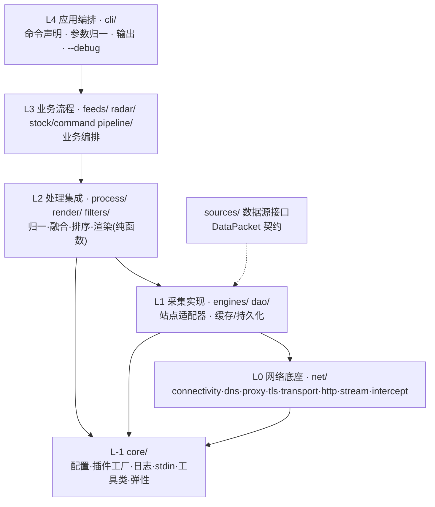
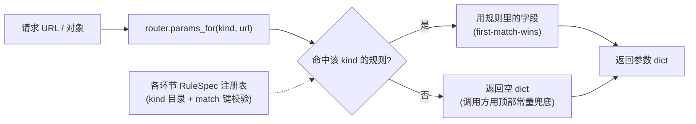

# webtool 重构优化提升方案（v2 架构）

> 目标：把「按 OSI 分层的网络底座 + 数据源→集成→功能→子命令→模块的分层数据流 + 规则驱动的特殊性 + 通用 --debug/stdin」收敛成一套体系，达到高内聚、低耦合、可插拔、可扩展、鲁棒。
>
> 本文是**设计方案**，不含实现。落地按「第七节 路线」分批推进，每批过 `tests/test_smoke.py`。

---

## 一、需求整理（把原始要求结构化）

| # | 原始要求 | 归类 | 目标形态 |
|---|---|---|---|
| R1 | 按 OSI 网络分层分包分模块，底层共用 | 架构·网络底座 | `net/` 内部按 L2→L7 职责归位，各层可独立复用 |
| R2 | ip-ping / dns / proxy / http / sse / websocket / tls证书 / 数据拦截与绕过 等为底座分层 | 架构·网络底座 | 每类一个模块，接口稳定，互不越层 |
| R3 | 数据源接口 → 数据处理集成 → 特定功能 → 子命令 → 模块 | 架构·数据流 | `sources → dao → core(业务) → pipeline/engine → cli` 单向依赖 |
| R4 | 数据层 / DAO 层 / 控制层 / 视图层 | 架构·分层 | 四层命名与目录对齐，依赖只许向下 |
| R5 | 适配器 / 工厂 / 策略 模式 | 设计模式 | 数据源=适配器、实例化=工厂、可替换行为=策略，且**有二实现才抽** |
| R6 | 多线程处理 + 恢复 | 弹性 | 并发/重试/熔断/断点恢复统一出口 |
| R7 | 每个环节都可能有"特殊情况"，用配置规则决定；特殊走规则，否则走通用 | 规则引擎 | 规则 kind 注册制，每环节自带通用默认值 |
| R8 | 规则粒度按对象（代理针对域名等） | 规则引擎 | 各 kind 声明自己的匹配维度 |
| R9 | 通用 `--debug` 参数，适配每个命令，分级配色，多日志便于定位 | 可观测性 | 全局注入，分级+配色+可落文件，标准埋点 |
| R10 | webtool 支持 stdin，管道读写 | 接口 | 文本命令统一读入口 + `-o -` 输出，形成管道范式 |
| R11 | 分包按层；文件分小（≤500 行） | 工程 | 大文件按职责拆子包 |
| R12 | 共用代码抽工具类/公共包 | 工程 | 重复≥3 处下沉 `core/` 工具类 |
| R13 | 高内聚、低耦合、扩展性、适配性、可插拔、鲁棒性、友好性、熔断 | 质量属性 | 见第八节 质量目标与判据 |

---

## 二、现状盘点（已有 vs 缺口）

**已具备（不是从零起步）：**

- 分层骨架：`cli → pipeline/render/feeds/stock → net/engines → core` 单向依赖，有 `tests/test_layering.py` 守卫。
- 规则引擎雏形：`net/rules/` 包的 `Router`，线路规则 + `params_for(kind)`；已接线 kind：`http / retry / breaker`。
- 全局 `--debug/-d`：`core/logging.py`，分级配色、stderr 输出、`WEBTOOL_DEBUG` 兜底，已接入 app 回调。
- stdin：`core/stdin.py`（`read_input/parse_lines/parse_jsonl`），`-o -` 输出侧已有。
- 弹性层：`core/resilient.py`（`parallel_map` / 重试退避 / 熔断 / checkpoint 雏形）。
- 插件工厂：`core/plugins.py` 八类注册表（engine/hot/site/extractor/resolver/filter/transformer/interceptor），懒解析 + 三层来源。

**缺口（本方案要补的）：**

| 缺口 | 现状问题 | 影响 |
|---|---|---|
| ~~G1 `net/` 内 OSI 归位不清~~ ✅P1 | `tls.py` 在 `core/`；ip/ping 探测在 `core/probe`；L4/L7 边界模糊 —— **已迁 `net/tls`·`net/http`·`net/connectivity`** | 已归位 |
| ~~G2 SSE / WebSocket 无独立通道~~ ✅P3 | 澄清: zen **并未** `http.client` 直连, 已走 `transport(stream=True)`; 真实缺口是 SSE 切帧+解压逻辑住在 CLI 层, 不可复用 | 已抽 `net/stream.py` |
| ~~G3 规则引擎不可扩展~~ ✅P2 | 已拆 `rules/` 子包 + `RuleSpec` 注册制；匹配器本就通用，补齐 kind 目录与 match 键校验 | 新增环节不改 rules 包 |
| G4 无统一数据源接口 | 规范提 `sources/`(DataPacket) 但搜索/抓取侧没有抽象，只有 stock 有 | R3/R4 落不了地；新数据源各写一套 |
| G5 大文件 | `transport.py 1093` / `proxy.py 989` / ~~`rules.py 923`~~ ✅P2 / `fetch.py 674` / `download.py 459` / `cli/app.py 870` / `zen/client.py 504` | 可读性/可维护性差 |
| G6 埋点不统一 | 各模块自发 `logger.debug`，字段/耗时/规则命中格式不一 | `--debug` 有了但排障仍靠翻代码 |
| G7 恢复能力窄 | checkpoint 只在 rank/feed/screen | 长任务（download/批量 fetch）无恢复 |
| G8 stdin 覆盖面 | 部分命令未接，无 jsonl 输入契约文档 | 管道组合能力不完整 |
| G9 错误/退出码不统一 | 各模块自定义异常与退出码 | 友好性差 |

---

## 三、目标架构

### 3.1 分层总图（依赖只许向下）

```
┌─ L4 应用编排   cli/            命令声明 · 参数归一 · 输出协议 · 通用 --debug
│                              (app / config / adminfmt / pkg / mcp / zen)
├─ L3 业务流程   feeds/ radar/ stock/command        能力域各自的编排
│                pipeline/      搜索编排 · 融合 · 排序 · 补量
├─ L2 处理集成   process/       归一化 · 去重 · 清洗 · 打分 (纯函数, 不出网)
│                render/        视图渲染 (纯函数)
│                filters/       结果过滤 (纯规则)
├─ L1 采集实现   engines/       站点适配器
│                dao/           缓存 · 持久化 · checkpoint · 快照
├─ L0 网络底座   net/           OSI L2→L7: 连通/dns/proxy/tls/http/stream/intercept
├─ L0' 数据契约  sources/       数据源接口 (SourceBase + DataPacket)
└─ L-1 基础      core/          配置 · 状态 · 插件工厂 · 日志 · stdin · 工具类 · 弹性
```



> 依赖只许向下（实线）；`sources/` 是契约层，被采集实现消费（虚线）。

**对齐 R3/R4：**

```
sources/       数据源接口层   DataPacket 契约, 不知道给谁用
dao/           DAO 层        缓存/落盘/checkpoint, 只管存取
process/       控制层        数据处理与集成 (纯函数)
engines/       控制层        站点适配器 (请求→解析→DataPacket)
cli/           视图层        渲染 + 输出 + 退出码
```

### 3.2 `net/` 的 OSI 归位（R1/R2 核心）

**原则**：OSI 是**依赖方向判据**，不是目录名。一块职责一个文件，文件缠两种职责才拆；子包之间禁止互相 import，组装只发生在一处（`net/transport.py`）。

```
net/
├── connectivity.py   L2/L3  连通性: TCP 握手探测 / 可达性缓存
│                             ← 已由 core/probe.py 迁入 (P1)
├── dns.py            L3     DNS 解析: 系统 resolver + 进程内缓存(含负缓存)
├── proxy.py          L3/L4  代理: 池 / 命名 / 按域名路由 / proxyhelper (拆见 3.3)
├── tls.py            L5     证书: CA 探测 · 校验策略 · verify_hosts (P1 由 core 迁入)
│                             ← 规范早已写 net/tls, 本次归位
├── transport.py      L4/L5  会话编排: DNS+代理+TLS+HTTP 组装 (工厂)
├── http.py           L7     HTTP 通道: urllib 兜底本体 (P1 由 core 迁入)
├── stream.py         L7     SSE iter_sse()/decompressor() + WebSocket 帧编解码 (P3)
├── download.py       L7     大文件: 分片 / 续传 / .part 原子改名
├── intercept.py      L7     拦截与绕过: captcha / spa 数据提取 / 反爬降级梯
├── rules/            —      规则引擎子包 (R7, 见第四节): spec/builtin/matchers/geodb/router/tidy/migrate/loader
└── netx.py           —      唯一门面: resolve_proxy / tls.policy / default_headers
```

**依赖方向（只许向下）**：`netx/transport → http/stream/download → proxy/tls/dns/connectivity`；`intercept` 只被 `transport/http` 回调，不反向。

**ip-ping 归位（P1 已做）**：`core/probe.py` 整体迁入 `net/connectivity.py`，调用点改 `webtool.net.connectivity`；**未留 `core/` 薄壳** —— 薄壳会让 `core → net` 反向依赖，与"core 不 import 上层"铁律冲突。同理 `core/tls`→`net/tls`、`core/http`→`net/http`。

### 3.3 大文件拆分（R11，逐个给落点）

| 现状 | 行数 | 拆法 |
|---|---|---|
| `net/transport.py` | 1093 | `transport/` 子包：`session.py`(指纹会话工厂) `request.py`(请求编排) `fallback.py`(cffi→urllib 降级梯) `__init__`(门面) |
| `net/proxy.py` | 989 | `proxy/` 子包：`pool.py`(命名代理池) `helper.py`(proxyhelper) `store.py`(配置读写/密钥) `route.py`(域名规则适配) |
| ~~`net/rules.py`~~ ✅ | 923 | **已拆** `rules/` 子包: spec(契约/kind注册) · builtin · matchers · geodb · router · tidy · migrate · loader |
| `net/fetch.py` | 674 | 请求侧并入 `net/http.py`；判型+落点分派留 `fetch.py`(or 直接归 `download.py` 调用) |
| `cli/app.py` | 870 | `cli/commands/` 每命令一文件，`app.py` 只留 `main()` + 注册 |
| `cli/zen/client.py` | 504 | `zen/`：`client.py`(编排) `stream.py`(改用 net/stream.open_sse) `parse.py` |
| `stock/` 大文件 | 675/660/497 | 按数据源/职责继续拆（沿用现有 mixin 切分原则） |

**判据**：>500 行且**承载两件以上事**才拆；一个类自然长到 600 行但只做一件事，不硬拆。

---

## 四、规则引擎 2.0（R7/R8，可扩展是重点）

### 4.1 现状 (P2 已落地)

`Router.params_for(kind, url)` **本就通用** (任意 kind 都能查), 原 `rules.py` 也没有
硬编码 kind 分支 —— 真正的缺口是"没有 kind 目录 / 没有 match 键校验 / 923 行单文件"。
P2 已把 `rules.py` 拆成 `rules/` 子包, 并加 `RuleSpec` 元数据注册制。

### 4.2 目标：kind 注册制 (已实现)

每个环节在自己的模块里声明一张 `RuleSpec` (kind 名 / 允许的动作字段 / 允许的匹配键 /
一句说明), 注册进 `rules.specs()`。`rules/` 包不认识任何具体环节的语义。

```python
# 环节模块顶部声明 (示例)
from webtool.net.rules import RuleSpec, register

register(RuleSpec(
    kind='retry',
    fields=('retries', 'backoff'),          # 该 kind 的动作字段
    match_keys=('domain', 'path'),          # 匹配维度 (粒度随对象)
    doc='按域名+路径的重试策略',
))
```

**默认值不在这里** —— 通用默认值仍住在各环节模块的顶部常量 (transport 的 15s、
resilient 的 retries/backoff/阈值), 那里是"无命中时"的唯一来源, 避免两处默认。

消费侧不变：

```python
params = rules.params_for('retry', url)   # 命中 → 该条目字段; 无命中 → {}
                                          # 调用方以自身顶部常量兜底
```



**收益**：新增环节（如 `dns` / `cache` / `render` / `engine` / `timeout`）只写一个 module 顶部声明 + 一个消费点，`rules.py` 零改动。

### 4.3 各 kind 的粒度（R8，按对象定）

| kind | 匹配维度（粒度） | 默认值住哪 | 消费者 |
|---|---|---|---|
| `route`（线路） | domain / cidr / port / scheme / geoip / asn | `rules.json.default` | netx |
| `http` | domain / path | transport 顶部常量 | transport |
| `retry` | domain / path | resilient 顶部常量 | resilient |
| `breaker` | domain | resilient 顶部常量 | resilient |
| `dns`（新） | domain / suffix | dns 顶部常量 | dns（如指定 DoH/自定义 resolver） |
| `cache`（新） | domain / path / scheme | cache 顶部常量 | dao/cache（TTL 覆盖） |
| `render`（新） | format（输出格式） | render 顶部常量 | render |
| `parse`（新） | domain（站点） | engines 顶部常量 | extractors（提取器选择） |

**规则模型统一**：`{ "kind": "...", "match": {...}, "…动作字段…", "priority": N }`；`match` 内多条件 AND，同条件多值 OR；first-match-wins（或无命中走 defaults）；**禁止在通用代码写 `if domain == 'xxx'`**。

---

## 五、设计模式（R5）

| 模式 | 落点 | 契约 | 门槛 |
|---|---|---|---|
| **适配器** | `sources/SourceBase` + `engines/*` | 请求→解析→校验→`DataPacket`；模板方法上提公共流程 | 有第二种数据源形态才抽基类 |
| **工厂** | `core/plugins.Registry` + `net/transport.session()` | 实例化一律走注册表/工厂，**禁止调用点 if-else 链** | 已具备，补 `sources` 工厂 |
| **策略** | `resilient.RetryPolicy` / `tls.Policy` / `extractors.pick_best` | 可替换行为用策略对象，实例来自注册表 | **只有一个实现不抽**，出现第二个再抽 |
| **门面** | `net/netx.py` | 上层只 import 门面，不碰内部子模块 | 唯一决策点（线路/TLS/UA） |
| **观察者(轻)** | logger 事件 | 进度/日志用 logger，不加回调参数 | — |

**新增 `sources/` 契约（G4）**：

```python
class DataPacket:                     # 统一数据契约 (纯数据结构)
    source: str; kind: str; items: list; meta: dict

class SourceBase(ABC):                # 数据源接口: 不知道给谁用
    name: str
    def fetch(self, req) -> DataPacket: ...   # 适配器实现
    def health(self) -> dict: ...             # 探活
```

数据源实现放 `sources/<name>.py`，经 `plugins.json` 的 `source` kind 登记 → 工厂注册表实例化。这样 R3 的"数据源接口层"从规范里的口号变成可落地的契约。

---

## 六、弹性 / 可观测 / 接口（R6 / R9 / R10）

### 6.1 弹性层（R6）

统一出口 `core/resilient.py`，业务模块**禁止自写线程池**：

- **并发**：`parallel_map(tasks, policy)`，`max_workers` 来自规则默认（全仓唯一来源，现为 4）。
- **重试**：指数退避 + jitter，次数/退避走 `retry` 规则；只重试幂等请求。
- **熔断**：按域名滑动窗口失败计数，打开即短路 + debug 日志；状态持久化。
- **恢复**：抽通用 `Checkpoint`（`dao/checkpoint.py`），key=任务指纹，value=已完成条目；`rank/feed/screen/download/批量fetch` 统一接入，重跑跳过已完成。

### 6.2 `--debug` 与日志 2.0（R9）

已有基础，**补强三点**：

1. **分级叠加**：`-d`(DEBUG) / `-dd`(更细，打请求头/体摘要) / `WEBTOOL_DEBUG` 兜底（已支持部分，补齐 `-dd`）。
2. **配色分级**：DEBUG 灰 / INFO 绿 / WARN 黄 / ERROR 红（已有），**新增 `-dd` 的 TRACE 青**；非 tty / `NO_COLOR` 自动去色（已有）。
3. **落文件**：新增 `--log-file <path>`，JSON Lines 结构化日志（字段：`ts/level/module/event/url/rule/elapsed_ms`），进程/Agent 可消费。

**标准埋点（强制）**：请求 URL · 规则命中(kind+action+rule index) · 重试次数 · 熔断状态 · 缓存命中 · 耗时。捕宽异常处必须 `logger.debug(..., exc_info=True)`，禁止 `except Exception: pass`。

### 6.3 stdin / stdout 管道协议（R10）

- 输入：文本命令统一 `core/stdin.read_input(arg)`，`-` 或"无参且 stdin 非 tty"读 stdin。
- 契约：`parse_lines`(url 列表) / `parse_jsonl`(逐行 JSON，坏行报行号)。
- 输出：`-o -` 已有；**补充约定**——`-f json` 的输出必须能被 `parse_jsonl` 回读（形成 `search | fetch | rank` 链）。
- 覆盖面：把未接 stdin 的文本命令补齐，写进 SKILL.md 的范式段。

### 6.4 SSE / WebSocket 通道（G2）

新增 `net/stream.py` 作为 L7 流式原语。**先说清楚**：早前 G2 写的"zenproto 用 `http.client` 直连出网"**不成立**——zen 一直走 `transport.request(stream=True)`，分层没问题（`_NET_CHANNELS` 那条注释失实）。真实缺口是 **SSE 的切帧+增量解压住在 CLI 层**（`cli/zen/client.py`），别处要用得重写。已落地：

```python
from webtool.net import stream as S
S.iter_sse(resp)          # transport 流式响应 → 逐行 (字节层切行 + 增量解压 + EOF flush)
S.decompressor(enc)       # 增量解压器 (gzip/deflate; br/zstd 明确报错)
S.ws_key() / ws_accept()  # WebSocket 握手; encode_frame()/FrameReader 帧编解码+分片+ping/pong
```

- 出网仍走 `transport`（指纹/线路/证书同源），本模块只管"裸流怎么切帧"。
- `cli/zen/client.py` 已改调 `iter_sse`（`_unzipper` 保留为兼容别名）；出网原语未变。
- **`open_ws` 建连未做**：需保持底层裸读写，curl_cffi 不暴露，另开 socket/CONNECT 要重接线路线路+证书，且**当前无消费方**——按"有消费方才立"不预造；协议层已就绪并有单测。
- 顺带修掉两个真 bug：① 解压器 EOF 不 `flush()` → 压缩流尾巴丢失；② `if not chunk: break` 把"解压后空输出"误判成 EOF → 压缩流被提前截断。

---

## 七、落地路线（增量，不破坏现有测试）

每批结束跑 `python3 tests/test_smoke.py` 全 PASS 才提交；`test_layering.py` 守卫依赖方向。

| 批次 | 内容 | 风险 | 交付物 |
|---|---|---|---|
| **P0** | 冻结本方案 + 更新 `docs/coding-standard.md` 对齐 | 无 | 本文 + 规范修订 |
| **P1** ✅ | `tls`/`http`/`connectivity` 从 `core` 迁 `net`（不留薄壳，调用点全量改）；**修复失效的分层守卫** | 低 | G1 归位 · 守卫生效 |
| **P2** ✅ | `rules.py` → `rules/` 子包 + `RuleSpec` 元数据注册制；内置 http/retry/breaker，match 键拼错告警 | 中 | G3 可扩展 |
| **P3** ✅ | 新增 `net/stream.py`: iter_sse + 解压器 + WS 帧编解码; zen 改调 iter_sse; 修 2 个压缩流真 bug | 中 | G2 通道 |
| **P4** | 拆 `transport/proxy/fetch/cli.app/zen.client` 大文件 | 中 | G5 文件粒度 |
| **P5** | 抽 `sources/`(DataPacket+SourceBase) + `dao/` + `process/` 层；`sources` kind 登记 | 高 | G4 R3/R4 |
| **P6** | `--log-file` JSON 日志 + 标准埋点补齐 + `-dd` | 低 | G6 R9 |
| **P7** | 通用 `Checkpoint` 铺到 download/批量 fetch；stdin 覆盖补齐 | 中 | G7/G8 R10 |
| **P8** | 统一错误类型 + 退出码规范 + 文档收尾 | 低 | G9 友好性 |

**每批自检**：新文件 ≤500 行 · 目录名即分层名 · 依赖方向未破 · 重复≥3 处已下沉 · 特殊行为全走规则 · 新路径有 `--debug` 埋点 · smoke 全 PASS。

---

## 八、质量目标与判据（R13）

| 属性 | 落地手段 | 可验证判据 |
|---|---|---|
| 高内聚 | 一包一能力域，一块职责一文件 | 文件 >500 行且多职责=0 |
| 低耦合 | 单向依赖 + 门面 | `test_layering.py` 无反向 import |
| 扩展性 | 规则 kind 注册制 + 插件注册表 | 新增环节不改 `rules.py`；新增引擎/源不改调用点 |
| 适配性 | `SourceBase` 适配器 + 端点 verbs 声明 | 新数据源只加一个 `sources/*.py` |
| 可插拔 | `plugins.json` 八类 + 新 `source` kind | 用户 `~/.webtool/plugins.json` 可覆盖/追加 |
| 鲁棒性 | 弹性层统一 + 降级梯 + 熔断 | cffi 崩→urllib；熔断打开短路有日志 |
| 友好性 | 统一错误类型/退出码/可读提示 + `--debug` 定位 | 非法值退 2 不静默；宽异常带 traceback |
| 熔断 | 按域名滑动窗口 | 规则可配 `fail_threshold/cool_seconds`，状态持久化 |
| 恢复 | 通用 checkpoint | 断点重跑跳过已完成条目 |

---

## 九、风险与取舍（防止好心办坏事）

- **不搞"为分层而分层"**：OSI 只回答"谁依赖谁"，不按 L1~L7 建目录；一个实现不抽策略基类。
- **P5 抽 `sources/`/`dao/` 风险最高**：stock 已有 `bridge/sources`（图灵完备的数据源层），搜索/抓取侧另起 `sources/` 可能双轨。**先做接口对齐调研**，能复用 `bridge` 的契约就复用，不新增第二套。
- **迁移不留薄壳**：`core/tls`→`net/tls`、`core/probe`→`net/connectivity`、`core/http`→`net/http` 一律**改全量调用点**，不在 `core/` 放 re-export 别名 —— 别名即 `core → net` 反向依赖，守卫会拒。
- **规则不是万能**：能靠默认路径覆盖的就不加 kind；加 kind 必须同时给通用默认 + 文档一条。
- **不动已验证的线路语义**：env 不作为决策源、不做隐式降级（先直连失败再代理）等既有铁律继续有效。
