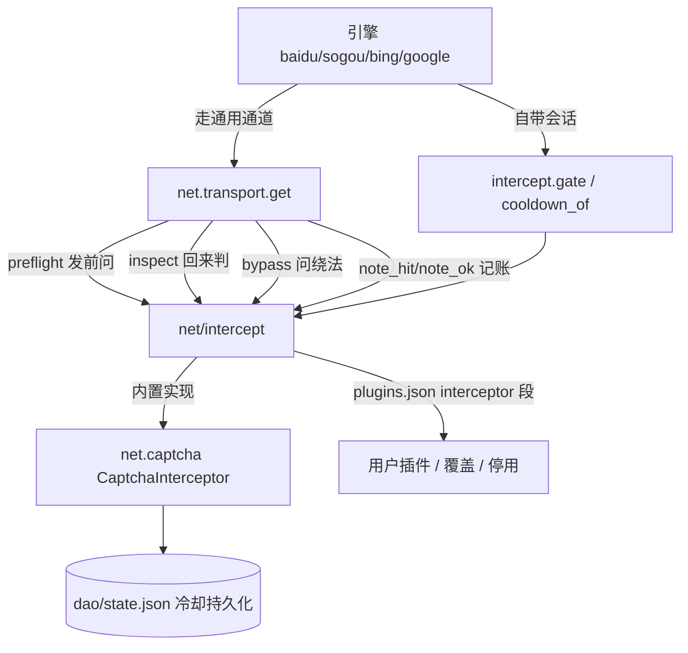
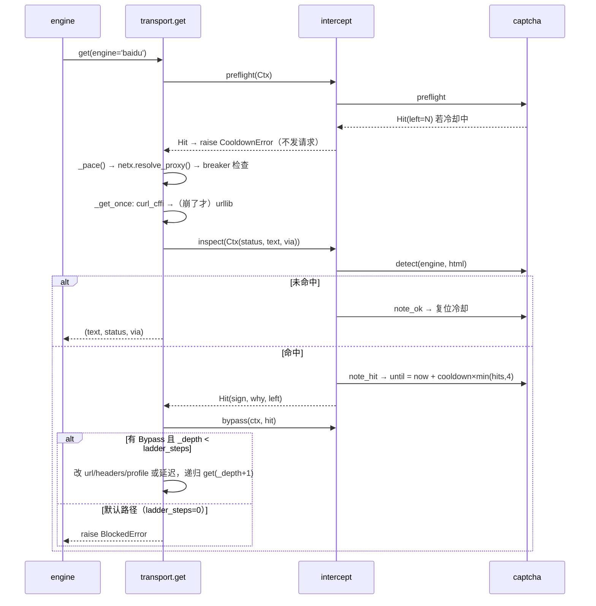

# webtool 拦截绕过模块分析

> 分析对象：`src/webtool/net/intercept.py`、`net/captcha.py`、`net/transport.py` 接线点、
> 引擎侧 `intercept.gate/cooldown_of`、`engines/gcaptcha.py`。
> 结论先行：抽象层做得很干净，但**默认配置下"绕过"实际是关的**，且唯一一条真正的
> 破解路径（Google reCAPTCHA）因导入路径写错而静默失效。

## 1. 模块边界



职责划分是这份代码最大的亮点：

- `transport` 不认识"验证码/WAF/限流"这些词，只问四件事：能不能发、是不是被挡、
  有没有绕法、记账。
- 判定特征全部外置到 `data/plugins.json` 的 `engine.<name>.params`，改指纹不用改代码。
- 新增拦截类型 = 写一个 `Interceptor` 子类 + 在 `plugins.json` 的 `interceptor` 段登记。

## 2. 抽象契约

| 方法 | 时机 | 返回 | 说明 |
|---|---|---|---|
| `inspect(ctx)` | 响应回来 | `Hit` / `None` | 抽象方法，必实现 |
| `preflight(ctx)` | 发请求前 | `Hit` / `None` | 只给会累计封禁的插件用（冷却门） |
| `bypass(ctx, hit)` | 判定被拦后 | `Bypass` / `None` | 换地址/换头/换指纹/延迟，只能改**下一次重试** |
| `note_ok(ctx)` | 未被拦 | — | 复位计数 |
| `note_hit(ctx, hit)` | 确认被拦 | — | 记冷却，并把剩余秒数写回 `hit.left` |

类属性决定"谁被调用"，不靠处理器内部自判：

| 属性 | 作用 |
|---|---|
| `hosts = (...)` | 只在这些域名上被调用；空 = 通用（每请求都看） |
| `cools_down = True` | 会记冷却 → 才参与 `preflight` / `note_ok` |
| `priority` | 判定顺序；以 `plugins.json` 为准 |

接口约定：

1. 报错文案不许认识具体插件，冷却剩余由 `note_hit` 写回 `hit.left`。
2. 优先级与启停以 `plugins.json` 为准，类属性只是默认值。
3. 插件加载/实例化/调用三处都 try，出错只记进 `_ERR`，不拖垮请求链路。

`_from_config()` 用 `enabled_only=False` 读表，这个细节是对的——否则"显式停用"会被
过滤成"从未存在"，内置实现会照跑。

## 3. 一次被拦请求的完整链路



关键参数：

- `DEFAULT_LADDER_STEPS = 0` —— **默认首次被拦即报错**，不重试、不走 `bypass`。
- 冷却只在 `_depth == 0` 检查，梯内重试不会撞上自己刚记的冷却。
- 熔断（`core.resilient`）按域名计，属于止损，不参与拦截判定。

## 4. 判定特征从哪来

通用段（任何引擎都生效）：

```
title_contains: captcha / verify / 安全验证
contains:       cf-challenge / Just a moment
```

引擎段（`data/plugins.json`）：

| 引擎 | 特征 | 冷却 | 节奏 |
|---|---|---|---|
| baidu | 标题"百度安全验证"、`wappass.baidu.com`、`mkdjump_v2`、正文 < 2000 字节 | 90s | 1.2s |
| sogou | `antispider`、标题"验证码"、`seccodeimage`、`403 forbidden`、正文 < 1300 字节 | 30s | 0.8s |
| google | `unusual traffic`、`/sorry`、`recaptcha` | 300s | 1.0s |
| bing | `challenge-form` | 30s | 0.5s |

`len_lt` 是很有效的启发式（验证页通常极短），但它把"正常但很短的页面"一并判死，
且 captcha 插件**没有 bypass**，误判的代价是引擎被锁 30~300 秒。

## 5. 绕过手段盘点

| 手段 | 实现 | 默认是否生效 |
|---|---|---|
| 浏览器指纹轮换 | `fingerprints.pick_profile` 按引擎固定档位；`impersonate` 与 UA 同源 | 是 |
| 请求节奏 | `pacing.pace` 每引擎最小间隔 + 随机抖动 | 是 |
| 线路切换 | `netx.resolve_proxy` + `rules` 规则表，一次请求一次定死 | 是 |
| 引擎级通道降级 | google web→news RSS、sogou PC→移动、baidu 预热会话→通用通道 | 是 |
| 域级熔断 | `resilient.Breaker`（止损，非绕过） | 阈值默认关 |
| 插件 `bypass` | `Interceptor.bypass` 返回换地址/换头/换指纹 | 是（有绕法时自动试一次，见 6.3） |
| Google reCAPTCHA 纯 HTTP 破解 | `engines/gcaptcha.py`：anchor token + sorry 表单回填 | 是（导入已修正，见 6.1） |
| 微信公众号 POC 校验 | `net/wechat.py`：识别后补 `chksm` 参数重取（见 9） | 是 |

也就是说：日常的"绕"是**换通道 + 换指纹 + 控节奏**，遇真验证页先按插件绕法试一次，
仍不行就换引擎。

## 6. 问题与修复

### 6.1 Google 验证码破解器导入路径错误（已修复）

`engines/google.py:99`：

```python
try:
    from webtool import gcaptcha as _gc   # 实际模块是 webtool.engines.gcaptcha
    ...
except Exception:
    pass                                   # ImportError 被吞掉
```

实测：

```
>>> from webtool import gcaptcha
ImportError: cannot import name 'gcaptcha' from 'webtool'
```

`webtool/__init__.py` 没有导出该子模块，`src/webtool/gcaptcha.py` 也不存在。
整个 try 块被 `except Exception: pass` 包住，所以表现为"每年都在解、从来没解过"：
Google web 通道被 reCAPTCHA 拦时直接抛错降级 news，`gcaptcha.solve()` 是死代码。
测试也没有覆盖它，因此长期无人发现。

修复：改为 `from webtool.engines import gcaptcha as _gc`。实测
`is_challenge()` 对 429 挑战页返回 `True`、普通页返回 `False`。

### 6.2 `dao/state.py` 不认 `WEBTOOL_DIR`（已修复）

`core/config_data.py`、`core/secrets_store.py` 都按 `WEBTOOL_DIR` 隔离用户目录，
但 `dao/state.py` 写死：

```python
PATH = os.path.expanduser('~/.webtool/state.json')
```

后果有两个，都已实测复现：

- 测试隔离失效：`tests/test_intercept_wiring.py` 设了 `WEBTOOL_DIR=临时目录`，冷却仍写进
  真实 `~/.webtool/state.json`（本次运行留下了 `wafsrv` 条目）。
- 多实例并行（不同 `WEBTOOL_DIR`）共享同一份冷却/熔断/cookie 状态，互相污染。

修复：路径改为按需计算 `_path()`（显式 `PATH` > `WEBTOOL_DIR` > `~/.webtool`），
缓存按路径区分，`info()` 也报当前真实路径。原有测试里 `state.PATH = ...` 的写法
仍然有效（显式设置优先级最高）。验证：跑 `test_intercept_wiring` 后真实
`~/.webtool/state.json` 的校验和不变。

### 6.3 `bypass` 扩展点在默认配置下不可达（已修复）

`transport` 只在降级梯内部调用 `intercept.bypass`，而 `ladder_steps` 默认 0。
插件作者照文档实现 `bypass` 后，不显式 `config set ladder_steps N` 就永远不执行，
且不会有任何提示。

修复：`_get_ladder` 先问绕法，`ladder_steps=0` 且有 `Bypass` 时把本次预算抬到 1 步，
只作用于顶层（`_depth==0`），失败即报错。这样插件契约生效，同时保持"1 次被拦不放大成
多次请求"的初衷。新增 `tests/test_bypass_default.py`（7 项）钉住三种情形：无绕法只打
一次、有绕法成功一次、绕法失败只多打一次。

### 6.4 通用验证页特征误判面（已修复）

`title_contains: verify` 与 `contains: Just a moment` 是全页小写匹配。正常文章标题带
"Verify"、正文引用了 "Just a moment" 都会被判成验证页。叠加"captcha 不绕 + 冷却单调
加长"，一次误判锁 30s，连续几次到 120s。

修复：通用段只保留整句/专有标记 —— 标题匹配 `captcha` / `安全验证` /
`verify you are human` / `just a moment` / `attention required`；正文匹配
`cf-challenge` / `checking your browser`。裸 `verify` 已移除，`Just a moment` 从
全页匹配收窄到标题匹配。

### 6.5 sogou 移动通道在插件体系外多判了一道（已修复）

`sogou.py` 移动端直接写死：

```python
if html and intercept.gate('sogou', html, url=M_ENDPOINT)[0] is None \
        and 'antispider' not in html.lower():
```

后半句绕过了所有拦截器，自定义插件无法覆盖或停用这条规则，与"引擎自探通道也要走
拦截器"的规范自相矛盾。

修复：删掉硬编码判断。`plugins.json` 的 sogou `captcha_signs` 本就含
`['contains','antispider']`，判定改由拦截器统一负责。

### 6.6 `_ERR` 粘滞（已修复）

`_run` 只在抛错时写 `_ERR`，成功时不清除。插件一次抖动后，`describe()`/`plugins check`
会一直报错，直到进程重建或 `reset()`。影响诊断准确性，不影响功能。

修复：`_run` 调用成功后 `_ERR.pop(name, None)`，恢复即消警。

## 7. 测试现状

- `tests/test_intercept.py`：28 项，覆盖注册、优先级、停用、错误隔离、`gate` 记账、
  "传输层不再直连 captcha"。
- `tests/test_intercept_wiring.py`：11 项，用本地 HTTP 服务跑完整 `transport.get`，
  覆盖冷却门、退避、`Bypass` 真的被执行。
- `tests/test_bypass_default.py`：7 项，覆盖 `ladder_steps=0` 下绕法的三种情形
  （无绕法不放大、有绕法成功一次、绕法失败只多打一次）。
- `tests/test_wechat_poc.py`：14 项，覆盖公众号校验页判定、`chksm` 绕法、
  专用提取（正文/图片消息/UI 不混入）与端到端换 URL 重取。

三组全部通过；跑接线测试后真实 `~/.webtool/state.json` 校验和不变（6.2 的验证）。

剩余缺口：`gcaptcha.solve()` 仍无端到端测试（挑战页评分依赖浏览器 VM，无法离线复现），
只验了 `is_challenge()` 的两条分支。

## 8. 顺带发现（与本模块无关，未改）

`tests/test_layering.py` 报 `net/pyshim.py` 违反分层：该文件延迟 import
`webtool.stock.bridge.sources._routing`（第 73/98/110 行），而 `net` 层规则禁止依赖
`stock`。属既有的层位越界，要修得把 `_routing` 下沉到 `net`，不宜顺手夹带。

## 9. 微信公众号 POC 校验绕过

### 现象

`mp.weixin.qq.com/s?...` 的链接**缺 `chksm` 参数**时，服务端判为"重构/抓取链接"：

- 302 → `/mp/wappoc_appmsgcaptcha?poc_token=…&target_url=…`（POC 人机校验）
- 或直接返回 `secitptpage/verify.html`，页面加载 `captcha.gtimg.com/TCaptcha.js`

带**任意** `chksm=` 值即恢复正文。实测三轮交替（`no-chksm` → 302，`chksm=abc123`
→ 200 / 3.4MB），因果稳定；追加 `scene`、`foo` 等无关参数无效 —— 是参数名规则，
不是取值校验。

### 实现

- `net/wechat.py` 的 `WechatPocInterceptor`（priority 15）：只认
  `mp.weixin.qq.com`；命中 `wappoc_appmsgcaptcha` / `secitptpage/verify` /
  `TCaptcha.js` 判为 `verify`；绕法是用 URL 的 CRC32 拼一个 `chksm` 追加。
  已带 `chksm` 仍被拦时返回 `None`，不硬试。
- 域名守卫是必须的：`intercept.bypass()` 会向所有插件征集兜底绕法，不守域名就会
  给任意被拦 URL 补 `chksm`（这条在测试里踩到过）。
- `pipeline/fetch.py`：fetch 走 `open_stream`（流式/二进制共用），本来不进拦截判定；
  新增 `_verify_bypass()` 在解码后过一遍拦截器，命中则按绕法**重取一次**，
  `--raw` / `--save` 落的是重取后的内容。
- `engines/wechat.py`：公众号页直接读 `#js_content`，输出标题/作者/段落/图片；
  图片消息给出 `image_post` 标记而不是空正文。通用提取器会把"点赞/在看/扫码"当正文。

### 验证

```
webtool fetch 'https://mp.weixin.qq.com/s?...&sn=69df…' -f markdown
# DEBUG: fetch | wechat 被拦 (secitptpage/verify), 采用绕法: 补 chksm 恢复公众号链接形态
# → 标题 + 公众号 + 长图
```

`tests/test_wechat_poc.py` 14 项全过；`test_intercept` / `test_intercept_wiring` /
`test_bypass_default` / `test_search_parallel` 无回归。

### 局限

只解决"链接形态触发"的 POC 校验。真正弹出 **TCaptcha 滑块**（非缺参导致）时，
纯 HTTP 无法通过，仍需要打码服务或浏览器内核 —— 插件在那种情况下返回 `None`，
由上层按冷却/降级处理，不会制造无效重试。

## 10. 分发与注册：从"每请求跑全插件"到"先筛后调"

原实现三个入口都遍历全部插件：`inspect`（判定）、`preflight`（冷却门）、
`note_ok`（复位）。其中 `note_ok` 每次成功回调 `state.reset_captcha()`，等于
**每个正常请求都写一遍 `state.json`**（原子 rename + fsync 级代价）。

现在：

1. **注册只走配置**。删掉代码里的 `_BUILTIN_SPEC` 硬编码清单，插件全部来自
   `plugins.json` 的 `interceptor` 段（包内默认 + 用户覆盖/停用/追加）。`register()`
   只服务测试与临时插件，同名时配置优先。
2. **按域名先分发**。插件声明 `hosts`，框架只把该域名的请求交给它；`hosts=()`
   的通用插件（`captcha`）才每请求都看。处理器里的域名判断上移到框架 —— 写在
   `inspect` 里就等于没有分发。
3. **只问会记账的插件**。`preflight` / `note_ok` 仅对 `cools_down=True` 或自己
   实现了该方法的插件执行；`note_ok` 在 `hits==0` 时直接返回，不再落盘。
4. **小写只算一次**。正文 `lower()` 缓存到 `Ctx`，各插件共用；`len_lt` 特征提到
   扫描之前，短页最快命中。
5. **绕法只问候选**。`bypass` 先问判定者，再问同域名候选，不再遍历全部插件。

实测（PRoot aarch64，`inspect` 单次，含小写）：

| 页面大小 | 非微信域名 | 微信域名 |
|---|---|---|
| 100 KB | 2.1 ms | 1.8 ms |
| 300 KB | 2.6 ms | 2.7 ms |
| 1 MB | 5.2 ms | 6.1 ms |

`tests/test_intercept_dispatch.py` 17 项钉住这些语义：配置注册与合并、优先级、
显式停用、非目标域名处理器零调用、`preflight`/`note_ok` 的挑选规则、`hits=0`
不落盘、停用后不再运行。

注意"少调"不等于"少判"：通用 `captcha` 仍要看每个请求的正文（它就是兜底检测），
省掉的是**其它插件的处理器**和**每请求的状态写盘**。
